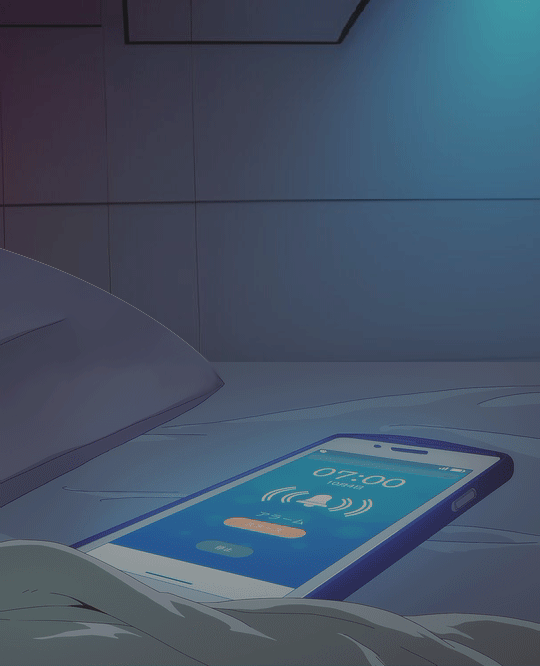
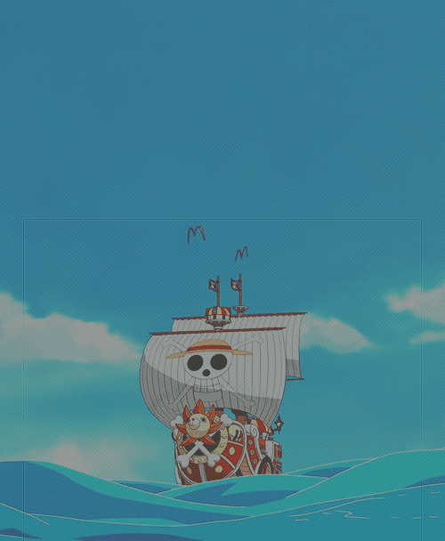
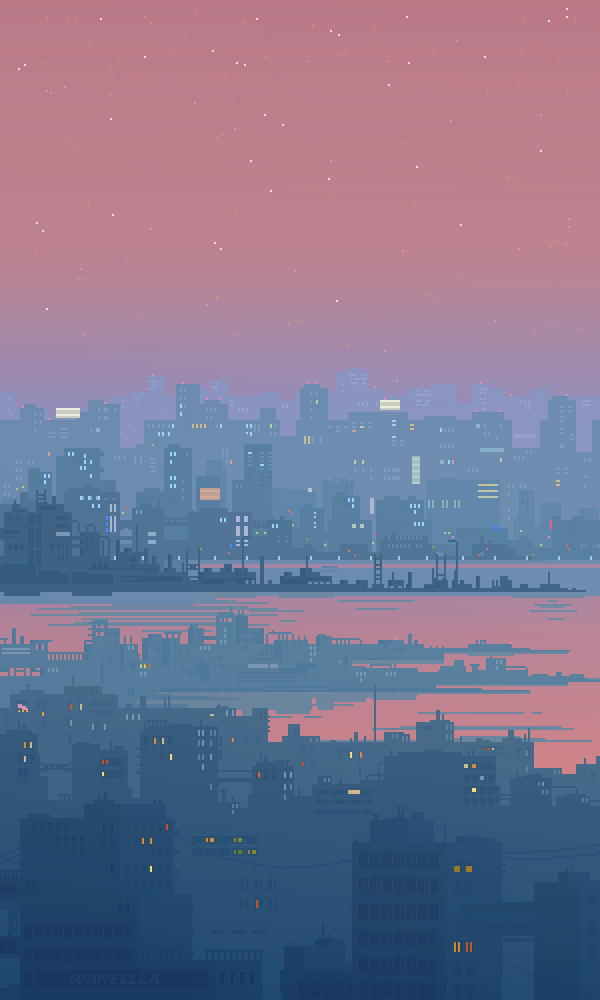
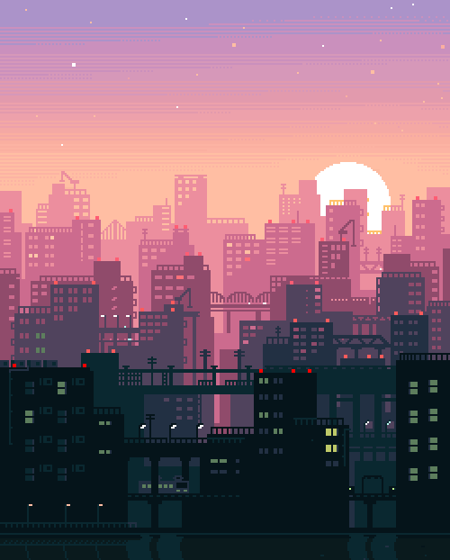
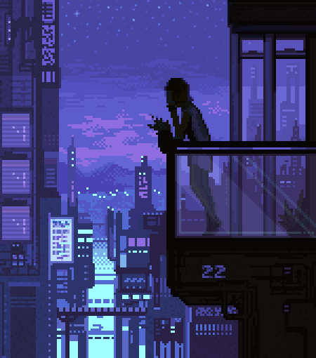
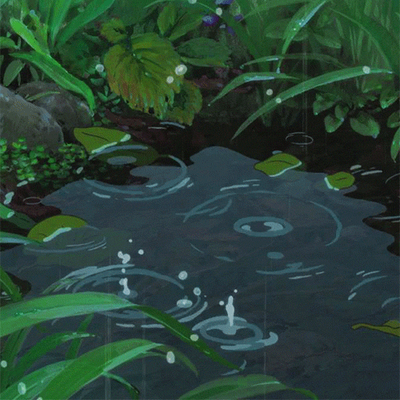

<h3 align="center">
  <br/>
  
  ✦ catppuccin <a href="https://pivoshenko.github.io/catppuccin-startpage">startpage</a> ✦
  
</h3>

<p align="center">
  <a href="https://github.com/pivoshenko/catppuccin-startpage/stargazers">
    
  </a>
  <a href="https://github.com/pivoshenko/catppuccin-startpage/issues">
    
  </a>
  <a href="https://github.com/pivoshenko/catppuccin-startpage/contributors">
    
  </a>
</p>

<p align="center">
  
</p>

---

> *pastel magic for your browser. soft, multilingual, and a little bit feral.* 🌙

a cozy catppuccin startpage — zero build tools, pure html/css/js, and a vibe that hits different every time you open a new tab. forked from [`dawn`](https://github.com/b-coimbra/dawn) and dressed up in moonlight ever since.

## ˗ˏˋ ★ what's new ˎˊ˗

fresh enchantments from the latest updates:

- 🌍 **localization expanded** — now fluent in **español `es`**, **english `en`**, and **esperanto `eo`**. weather strings, category names, ai messages, and date formats all properly localized, because your startpage should speak your language/s 🌿
- 🕰️ **clock glow-up** — localized date/time formats, click to toggle compact/extended mode, plus optional multi-timezone clocks (for those of us living across multiple meridians in our head)
- ☁️ **weather vibes** — better translated conditions (fog! mist! haze! they're different! finally!), friendly fallback when the api ghosts you, with optional technical details tucked into the tooltip
- 🔮 **claude magic** — ai search now asks claude first (gemini steps in when claude's down), with quick actions, sources, full markdown rendering (code, lists, tables, links, images), and a clean `g` → `Enter` flow to summon your answers
- 🎨 **aesthetic updates** — dynamic tab flavour styling, new `src/img/bg-main.jpg` background asset, and freshened docs
- 📡 **works offline** — a service worker caches the app shell so your new tab still opens with no connection (weather/ai need network, everything else doesn't)

## ˗ˏˋ ★ themes & palettes ˎˊ˗

catppuccin's four flavours: `latte` ☕  `frappé` 🧋  `macchiato` 🌙  `mocha` 🍫

automatic light/dark theme detection — the page reads the room. soft, expressive, and zero clutter because clutter is for people who haven't unlocked the aesthetic yet.

## ˗ˏˋ ★ setup ritual ˎˊ˗

1. fork and clone this repository
2. (optional) remove `.github` if you don't need issue/pr templates
3. open [`userconfig.js`](userconfig.js) — this is your grimoire. the *only* file you need to touch:
   - choose your palette & theme behavior
   - set your weather location and temperature scale
   - configure tabs, categories, and links
   - pick your banner and background
   - tune the ai + i18n in `advanced_config`
4. refresh your page ✨

that's genuinely it.

## ˗ˏˋ ★ claude — the crystal ball ˎˊ˗

dual-mode search is built in — duckduckgo for when you know what you're looking for, claude for when you want to ask something actually interesting. if claude is down or out of credit, gemini picks up the ball (if you gave it a key too), so the crystal ball never goes dark.

### shortcuts

| key | what it does |
|-----|--------------|
| `g` | open search, straight into ai mode |
| `/` | open search |
| `Tab` | toggle duckduckgo ↔ ai |
| `Alt+1..9` | quick actions: translate, define, summarize a link, web search, eli5, code |
| `Enter` | cast the spell |
| `Esc` | close the modal |

### api key

make one at [platform.claude.com](https://platform.claude.com/) (the api is pay as you go and separate from a claude pro subscription — a few dollars lasts ages), then run this in your browser console:

```javascript
localStorage.setItem('CLAUDE_API_KEY', 'your-api-key-here');
// optional backup:
localStorage.setItem('GEMINI_API_KEY', 'your-api-key-here');
```

never put a key in `userconfig.js` if your repo is public — use localStorage, or a local `secrets.js` (it's gitignored). keep your secrets secret 🌿

by default claude only searches the web when you ask it to (`Alt+4`), which keeps plain questions at fractions of a cent.

full setup guide: [AI_SETUP.md](AI_SETUP.md)

## ˗ˏˋ ★ weather — reading the sky ˎˊ˗

weather ships with a shared free-tier [openweathermap](https://openweathermap.org/api) key out of the box, so it just works — no setup required. it's public and rate-limited, so if you want your own key, grab one for free and run this in your browser console:

```javascript
localStorage.setItem('OWM_API_KEY', 'your-api-key-here');
```

this persists across sessions and takes priority over `userconfig.js`, so your key never ends up in a commit. you can also set `window.OWM_API_KEY` or `advanced_config.weather.apiKey` directly in `userconfig.js` — just don't push that to a public repo, okay? keep your secrets secret 🌿

full setup guide: [WEATHER_SETUP.md](WEATHER_SETUP.md)

## ˗ˏˋ ★ localization (i18n) ˎˊ˗

currently speaks:

- `es` — español 🌸
- `en` — english 🍃
- `eo` — esperanto 🌙

set your default in `advanced_config.i18n.defaultLocale` inside [`userconfig.js`](userconfig.js). or switch on the fly from the console:

```javascript
window.i18n.setLocale('es');
location.reload();
```

full guide: [LOCALIZATION.md](LOCALIZATION.md)

## ˗ˏˋ ★ offline ˎˊ˗

`sw.js` caches the app shell (html/css/js + favicon) on first visit, cache-first after that — so opening a new tab with no connection still works. weather and the ai always hit the network since caching those would just show you stale data.

only kicks in when served over `http(s)` (github pages, a local server, etc.) — service workers don't run on `file://`. made a change to a core file and it's not showing up? bump `CACHE_VERSION` in `sw.js` to invalidate the old cache, or unregister it from devtools → application → service workers.

## ˗ˏˋ ★ config flags worth knowing ˎˊ˗

inside [`userconfig.js`](userconfig.js):

- `overrideStorage` — file config wins over localStorage (useful when you actually know what you want)
- `localIcons` / `localFonts` — use bundled assets for better offline behavior & faster loading
- `openLastVisitedTab` — picks up where you left off on reload
- `additionalClocks` — add clocks by iana timezone (e.g. `America/Bogota`, `Asia/Tokyo`)

## ˗ˏˋ ★ homepage / new tab ˎˊ˗

**homepage:** browser settings → set homepage url → point it here

**new tab:**
- firefox: [Custom New Tab Page](https://addons.mozilla.org/en-US/firefox/addon/custom-new-tab-page/?src=search)
- chromium/brave: [Custom New Tab URL](https://chrome.google.com/webstore/detail/custom-new-tab-url/mmjbdbjnoablegbkcklggeknkfcjkjia)

## ˗ˏˋ ★ banners ˎˊ˗

all animated gifs — pick yours in `userconfig.js` 🌙

| banner_01 | banner_02 | banner_03 | banner_04 |
| --- | --- | --- | --- |
|  |  |  |  |

| banner_05 | banner_06 | banner_07 | banner_08 |
| --- | --- | --- | --- |
|  |  |  |  |

| banner_09 | banner_10 | banner_11 | banner_12 |
| --- | --- | --- | --- |
|  |  |  |  |

| banner_13 | banner_14 | banner_15 | banner_16 |
| --- | --- | --- | --- |
|  |  |  |  |

| banner_17 | banner_18 |
| --- | --- |
|  |  |

> bonus: `src/img/bg-main.jpg` for a full-page background ✦

## ˗ˏˋ ★ credits ˎˊ˗

- catppuccin palette: [catppuccin.com](https://catppuccin.com/palette)
- original inspiration: [`dawn`](https://github.com/b-coimbra/dawn)

if you make your own variation, share it. the world needs more witchy startpages 🌙 ✦
